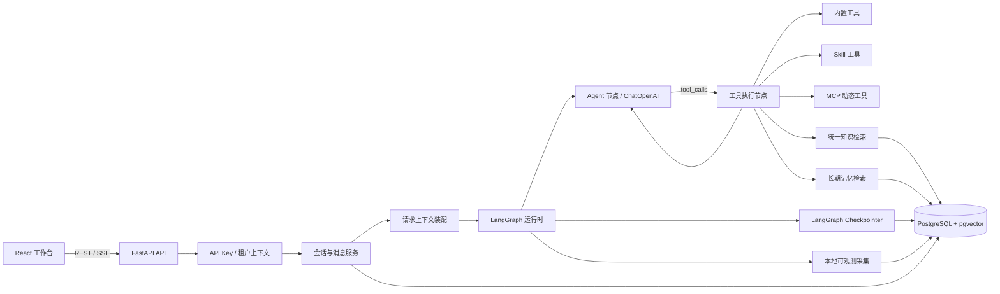

# MyAgentDemo1 — Agent Harness

MyAgentDemo1 是一个面向企业内部 Agent 应用的全栈开发底座。项目把
LangGraph Agent 运行时、会话与流式对话、工具和 Skill、MCP、RAG 与
Graph RAG、长期记忆、本地可观测性，以及治理能力组合在同一套可运行的
FastAPI + React 工作台中。

这个仓库更适合作为 Agent 平台的工程参考、功能验证环境和二次开发起点，
而不是无需改造即可直接上线的成品。当前鉴权仍是 API Key 模型，用户身份
使用匿名占位符，细粒度 RBAC、生产级身份系统，以及完整多 Agent 调度仍需
根据实际业务补充。

## 当前能力

项目已经形成从对话入口到运行观测、知识治理和能力扩展的完整开发
闭环。
下表区分默认可用、需要外部服务，以及仍处于骨架或可选状态的能力。

| 能力域 | 当前实现 | 使用边界 |
| --- | --- | --- |
| 对话与会话 | 会话 CRUD、历史恢复、REST、SSE、模型切换、附件上下文 | 图片理解需要选择支持视觉输入的模型 |
| Agent 运行时 | LangGraph `StateGraph`、ReAct 工具循环、Postgres Checkpointer、超时和恢复接口 | 工具前 HITL 默认关闭 |
| 工具系统 | 内置工具、请求级动态工具、工具白名单和输出大小限制 | 工具授权仍需结合业务权限系统增强 |
| Skill | 发现、启停、重载、导入、删除和安全资源读取 | 外部 Skill 默认停用；脚本型 Skill 需审查后启用 |
| MCP | Server 管理、连通性测试、能力发现、动态工具注入、凭据加密 | 默认关闭；当前主要支持远程 Streamable HTTP |
| 标准 RAG | 文档解析、分块、向量/关键词混合检索、RRF、Rerank、引用 | Embedding 和 Rerank 依赖已配置的外部服务 |
| Graph RAG | 实体、关系、事件、社区、图谱构建、图检索和可视化工作台 | 仅 `graph_enhanced` 知识库参与自动建图 |
| 统一知识检索 | `auto`、`text`、`graph`、`fused` 路由与降级 | 图谱未就绪时自动模式降级到文本检索 |
| 长期记忆 | 对话后提炼、判重、冲突调和、TTL、检索注入、管理页面 | 当前所有请求使用匿名用户占位符 |
| 可观测性 | Trace/Span、运行事件、调用、日志、成本、质量、告警和导出 | 默认仅采集元数据；正文采集需显式开启 |
| 多租户与治理 | API Key、租户字段隔离、审计日志、指标和成本价目 | `X-Tenant-Id` 当前直接受信任，不等同于生产 RBAC |
| 多 Agent | Agent 注册表、Supervisor 和演示子 Agent 骨架 | `MULTI_AGENT_ENABLED=false`，尚非默认主链路 |

## 系统架构

系统采用前后端分离结构。React 工作台通过 REST 和 SSE 调用 FastAPI；
FastAPI 负责鉴权、会话、上下文装配和持久化；LangGraph 运行时负责模型与
工具循环；PostgreSQL 同时保存业务数据、向量、图谱、Checkpoint 和观测数据。



一次流式对话请求会经过以下主链路：

1. 前端创建或选择会话，并提交模型、Skill、知识库、MCP 能力和附件引用。
2. API 校验 `X-API-Key`，解析租户，并加载会话和消息历史。
3. 服务端解析附件、知识库白名单、长期记忆和请求级 MCP 工具。
4. `GraphRuntime` 运行 Agent 节点；模型产生工具调用时进入工具节点并循环。
5. SSE 持续返回 Trace、步骤、工具、文本增量、引用、错误和结束事件。
6. 服务端保存消息与 Token 数据，并异步提炼长期记忆和写入观测数据。

## 功能说明

下面各节按用户实际使用路径说明已落地功能，以及启用这些功能所需的
条件。

### 对话工作台

对话页采用三栏工作区：左侧管理会话和功能入口，中间显示消息与
运行过程，右侧展示当前模型、Skill、MCP、知识库和可用工具。主要能力
包括：

- 创建、切换和删除会话，并从 PostgreSQL 恢复历史消息。
- 使用 REST 获取完整结果，或使用 SSE 接收逐步运行事件和文本增量。
- 在单次请求中指定模型、启用的 Skill、知识库和 MCP Tool。
- 展示工具步骤、耗时、错误、Token、Trace 入口和知识引用。
- 上传图片、PDF、DOCX、文本、代码和常见结构化文本作为临时上下文。
- 每条消息最多上传 6 个附件，单文件默认不超过 20 MB。
- 对 Markdown、GitHub Flavored Markdown 和检索来源进行结构化渲染。

聊天附件按租户和会话隔离落盘。文档附件会提取文本后放入本次模型
上下文；
图片会转换为 Data URL，因此只有支持视觉消息的模型才能正确处理图片。

### Agent 运行时

主图位于 `backend/app/harness/graph_builder.py`，使用一个可循环的 ReAct
结构：`START → agent → tools → agent → END`。运行层还负责：

- 使用请求级 `ToolContext` 注入模型、租户、用户、知识库和动态工具。
- 使用 LangGraph `astream_events(version="v2")` 生成统一 SSE 事件。
- 使用 Postgres Checkpointer 保存线程状态；初始化失败时退回无持久化模式。
- 对 Agent 运行设置递归次数和总超时限制。
- 支持中断恢复 API，并为前后两段 Trace 建立关联。
- 将 LLM、工具、Retriever、Embedding 和节点运行映射为父子 Span。

`GRAPH_INTERRUPT_TOOLS` 可以在工具执行前插入中断，但默认值为 `false`。
`MULTI_AGENT_ENABLED` 也默认关闭；当前注册表、Supervisor 和演示子 Agent
主要用于后续扩展，不代表主对话链路已经启用完整多 Agent 编排。

### Skill 与 MCP 能力中心

Skill 和 MCP 共享前端“插件”页面，但在运行时保持不同生命周期。Skill 是
本地可审计资源，MCP 是远程服务暴露的动态能力。

Skill 管理支持以下操作：

- 从仓库内 `skills/` 和外部 Skill 目录发现 `SKILL.md`。
- 查看元数据、资源文件数量和是否包含脚本。
- 启用、停用和重载 Skill，并在变化后重建 Agent 工具集。
- 导入单个 Markdown、文件夹、ZIP 或 TAR 包。
- 拒绝路径穿越、符号链接、凭据文件和不安全归档内容。
- 通过受限内置工具读取已注册 Skill 的资源文件，单次默认上限为 256 KB。

外部 Skill 导入后默认停用。界面或 API 显式传入 `activate=true` 才会启用，
这让你可以在运行脚本或暴露新工具前先审核内容。

MCP 管理支持 Server CRUD、健康检查、能力发现、工具级启停和请求级动态
注入。当前默认配置只允许远程 HTTP，并关闭 stdio：

```env
MCP_ENABLED=false
MCP_REMOTE_HTTP_ENABLED=true
MCP_STDIO_ENABLED=false
```

生产环境必须配置固定的 `MCP_SECRET_KEY`。该密钥用于加密持久化的请求头；
更换密钥后，数据库中的旧凭据无法解密，需要重新配置对应 MCP Server。

### 知识库与标准 RAG

知识库不是单一的“上传后搜索”接口，而是一套带状态、任务、调试和
评测的索引工作台。每个知识库都拥有独立的租户、模式、文档、分块和
检索设置。

标准 RAG 流程包含以下阶段：

1. 校验并保存 `.md`、`.txt`、`.pdf` 或 `.docx` 文件。
2. 使用本地解析器提取文本，或在配置 GLM Files API 后使用 OCR/版面解析。
3. 按 Markdown 标题、表格和固定长度规则分块。
4. 调用 OpenAI 兼容 Embedding 服务并写入 pgvector。
5. 使用向量、`pg_trgm` 关键词或混合策略召回候选。
6. 使用 RRF 融合候选，并在 Rerank 服务可用时执行精排。
7. 返回 `kb_id`、`doc_id`、`chunk_id`、源文件和检索通道等引用信息。

管理页面提供知识库总览、文档任务、分块预览与编辑、分块启停、重新
向量化、测试检索、评测运行和索引设置。解析和图谱任务会持久化到
`knowledge_index_jobs`；应用重启后会恢复排队任务，并将超时任务重新置为
可处理状态。

#### macOS 本地 Rerank 服务

Apple Silicon 开发机使用独立 FastAPI 进程加载
`BAAI/bge-reranker-v2-m3`。该服务通过 MPS 执行 Cross-Encoder 推理，
并提供主后端直接兼容的 `/v1/models` 和 `/v1/rerank` 接口。

使用统一开发脚本时，Rerank 服务会和前后端一起启动：

```bash
./start.sh start
```

首次启动会创建 `backend/.venv-rerank` 并下载模型权重。统一脚本会等待模型
加载完成，再启动主后端。你可以在其他终端检查全部服务状态：

```bash
./start.sh status
curl http://127.0.0.1:1235/v1/models
```

默认后端配置为：

```env
RERANK_ENABLED=true
RERANK_BASE_URL=http://127.0.0.1:1235/v1
RERANK_MODEL=text-embedding-bge-reranker-v2-m3
RERANK_USE_FLAG_EMBEDDING=false
```

`./start.sh stop` 和 `Ctrl+C` 都会同时停止前端、后端、Worker 和 Reranker。
如果你只想管理 Rerank 服务，可以继续使用独立脚本：

```bash
./start-reranker.sh start
./start-reranker.sh stop
./start-reranker.sh foreground
```

可通过 `RERANK_SERVER_DEVICE=cpu` 强制使用 CPU，或通过
`RERANK_SERVER_BATCH_SIZE` 和 `RERANK_SERVER_MAX_LENGTH` 调整内存占用。
如果不需要本地 Reranker，可执行 `START_RERANKER=false ./start.sh start`。
服务默认只监听 `127.0.0.1`；需要让局域网内其他机器访问时，可设置
`RERANK_SERVER_HOST=0.0.0.0`，并通过 macOS 防火墙限制来源。
修改主后端 `.env` 后必须重启主后端进程。

### 索引模式与 Graph RAG

Graph RAG 是标准文本索引的增强通道，不是另一套互斥的知识库产品。创建
知识库时可选择以下模式：

| 模式 | 文本索引 | 图谱索引 | 适用场景 |
| --- | --- | --- | --- |
| `standard` | 始终启用 | 不自动构建 | 精确事实、段落查找、普通问答 |
| `graph_enhanced` | 始终启用 | 按自动或手动策略构建 | 实体关系、多跳问题、时间线、全局概括 |

图谱构建会从分块中抽取实体、关系和事件，执行别名归一化，生成社区
摘要，并记录证据分块。图谱工作台支持构建或重建、状态查看、实体和
关系浏览、子图可视化、实体编辑与合并、事件时间线和图检索。

每个文档还可以设置 `inherit`、`include` 或 `exclude`。标准知识库不允许
强制 `include`；增强知识库可以继承库级策略、强制参与或排除。该约束同时
存在于数据库、服务和 API 层。

统一检索提供 `auto`、`text`、`graph` 和 `fused` 四种模式：

- `auto` 使用确定性查询分类；关系、多跳、时间线等问题优先融合检索。
- `text` 只运行向量/关键词混合文本检索。
- `graph` 只运行图谱检索并返回相关实体、关系、事件和证据分块。
- `fused` 合并文本与图谱证据，并按 `chunk_id` 去重。

当图谱未启用、未就绪或通道执行失败时，自动/融合模式会记录降级
原因，并尽量保留文本结果。显式 `graph` 请求不会伪装成成功的文本
检索结果。

### 长期记忆

长期记忆按 `(tenant_id, user_id)` 隔离，分为语义记忆和情景记忆。对话完成
后，后台任务从本轮问答中提炼值得跨会话保留的内容，再执行以下流程：

- 低置信度候选进入 `pending`，不会参与自动检索。
- 高相似候选执行判重，并强化已有记忆的访问计数。
- 冲突区间由 LLM 选择新增、更新或合并；失败时保守新增。
- 有效记忆通过向量相似度和时间衰减排序，在后续对话前注入。
- TTL 扫描将过期且未被强化的记忆标记为 `expired`。

记忆页面提供关系图、时间线和列表三种视图，并支持按类型和状态
筛选、编辑、删除、清空，以及控制长期记忆、自动提炼和 TTL 设置。

当前 `require_auth` 使用 `ANONYMOUS_USER_ID` 作为统一用户 ID。接入真实登录
系统后，必须从认证凭据解析稳定用户 ID，才能实现同一租户内的用户级
隔离。

### 本地可观测性

项目已从 LangSmith 主链路迁移到本地可观测体系。采集器基于 LangGraph
真实事件流建立 Trace 和父子 Span，并把数据写入 PostgreSQL。

观测台包括以下视图：

- 总览：请求量、成功率、Token、P50/P95 延迟和趋势。
- 运行记录：Trace 筛选、状态、耗时、Token 和工具调用。
- Trace 详情：输入、模型和工具泳道，事件序列、Span 树和检查器。
- 调用分析：LLM、工具、Retriever、Embedding、记忆和节点调用。
- 日志：按级别查询，并通过 Trace ID 关联具体运行。
- 成本：使用模型价格版本计算输入、输出和总成本。
- 质量：人工评分、评测结果和质量趋势。
- 告警：SLO 规则、告警事件和处置状态。

`CONTENT_CAPTURE_MODE` 控制保存的内容范围：

| 值 | 行为 |
| --- | --- |
| `metadata_only` | 只保存结构和指标，不保存输入/输出摘要；默认值 |
| `redacted` | 保存经过敏感字段过滤和截断的摘要 |
| `full` | 保存更完整内容；仅适合明确完成合规评估的环境 |

如果你需要在 Trace 详情中查看 Input，至少把该值设为 `redacted`，并只检查
修改配置后新产生的 Trace。历史 Trace 不会被自动回填。

## 技术栈

项目选择成熟的 Python、TypeScript 和 PostgreSQL 组件，避免把核心状态锁定
在某一家模型服务中。

| 层级 | 主要技术 |
| --- | --- |
| Agent | LangGraph 1.x、LangChain Core、`langchain-openai` |
| 后端 | Python 3.11+、FastAPI、Pydantic 2、SQLAlchemy 2、Uvicorn |
| 数据 | PostgreSQL、pgvector、`pg_trgm`、LangGraph Postgres Checkpointer |
| 可观测 | OpenTelemetry、Traceloop、本地 Trace/Span/日志/聚合表 |
| 前端 | React 18、TypeScript 5、Vite 5、React Router、Zustand |
| UI 与图表 | Ant Design 5、ApexCharts 6、Cosmograph |
| 部署 | Docker、Docker Compose、Nginx |

模型、Embedding、Rerank、GLM 文件解析和 Graph 抽取都通过配置连接外部服务。
LLM 与 Embedding 接口遵循 OpenAI 兼容调用方式；Rerank 服务需要提供兼容的
`/rerank` 端点。

## 目录结构

仓库按运行职责划分。以下目录是二次开发时最常访问的入口。

```text
MyAgentDemo1/
├── backend/
│   ├── app/
│   │   ├── agents/            # Agent 抽象、注册表和演示子 Agent
│   │   ├── api/               # FastAPI 路由、鉴权依赖和请求模型
│   │   ├── chat/              # 聊天附件校验、存储和上下文转换
│   │   ├── harness/           # LangGraph 图、运行时、事件和会话管理
│   │   ├── knowledge/         # 解析、分块、索引、检索、评测和 Graph RAG
│   │   ├── mcp/               # MCP 连接、发现、凭据和动态工具
│   │   ├── memory/            # 长期记忆提炼、检索、调和和清理
│   │   ├── observability/     # Trace、日志、指标、成本和告警
│   │   ├── security/          # API Key 和租户上下文
│   │   ├── skills/            # Skill 加载、导入和生命周期
│   │   ├── storage/           # SQLAlchemy 模型、仓储和 Checkpointer
│   │   └── tools/             # 内置、知识、记忆和 MCP 工具适配
│   └── tests/                 # 后端单元与集成测试
├── frontend/
│   └── src/
│       ├── api/               # REST 与 SSE 客户端
│       ├── components/        # 工作区、聊天、知识、图谱和观测组件
│       ├── pages/             # 对话、插件、知识库、记忆、设置和观测页面
│       ├── stores/            # 会话和设置状态
│       └── styles/            # 全局主题与布局样式
├── skills/                    # 仓库内置 Skill
├── deploy/                    # Compose、Nginx 和 PostgreSQL 初始化
├── docs/                      # 规格、研究、集成和交付说明
└── start.sh                   # 本地开发启动、停止和状态检查
```

## 快速开始

本地开发脚本会检查 PostgreSQL、创建数据库和角色、启用 pgvector、
准备依赖，并启动前后端。它最符合当前仓库的开发路径。

### 环境要求

运行完整功能前，需要准备以下环境：

- Python 3.11 或更高版本。
- Node.js 20 或兼容版本，以及 npm。
- PostgreSQL，并安装 pgvector 扩展。
- 一个 OpenAI 兼容的聊天模型服务。
- 一个与 `EMBEDDING_DIM` 匹配的 Embedding 服务。
- 可选：Rerank、GLM Files、Graph 抽取模型、MCP 和 OTLP 服务。

macOS 使用 Homebrew 时，可先启动本地 PostgreSQL：

```bash
brew services start postgresql@15
brew install pgvector
```

### 使用本地启动脚本

先准备后端配置，再启动整个开发环境：

```bash
cp backend/.env.example backend/.env
```

至少检查并修改以下值：

```env
LLM_MODEL=deepseek-chat
LLM_BASE_URL=https://api.deepseek.com
LLM_API_KEY=your-api-key

EMBEDDING_MODEL=text-embedding-bge-m3
EMBEDDING_BASE_URL=http://127.0.0.1:1234/v1
EMBEDDING_API_KEY=local-key
EMBEDDING_DIM=1024
```

`EMBEDDING_DIM` 必须与模型输出维度以及数据库向量列一致。当前开发期
自动建表逻辑发现 `knowledge_chunks.embedding` 维度不一致时，会删除并
重建该向量列。已有数据环境必须先备份并使用正式迁移方案，不能直接依赖
这一开发期行为。

然后运行：

```bash
./start.sh start
```

脚本在前台保持运行，按 `Ctrl+C` 停止。也可以在其他终端查看或停止服务：

```bash
./start.sh status
./start.sh stop
```

启动完成后可访问：

- 前端工作台：<http://localhost:5173>
- 后端健康检查：<http://localhost:8000/api/v1/health>
- OpenAPI 文档：<http://localhost:8000/docs>

本地默认 API Key 是 `sk-dev-key-1`。前端会自动使用它，也可以在设置页修改。

### 手动启动

如果你希望分别控制前后端，先准备数据库和扩展：

```sql
CREATE DATABASE harness;
\c harness
CREATE EXTENSION IF NOT EXISTS vector;
CREATE EXTENSION IF NOT EXISTS pg_trgm;
```

启动后端：

```bash
cd backend
python3 -m venv .venv
.venv/bin/pip install -r requirements.txt
cp .env.example .env
.venv/bin/python -m uvicorn app.main:app \
  --env-file .env \
  --reload \
  --host 0.0.0.0 \
  --port 8000
```

启动前端：

```bash
cd frontend
npm install
npm run dev
```

Vite 开发服务器会把 `/api` 代理到 `http://localhost:8000`。

### Docker Compose

仓库提供 Compose 模板，可启动 PostgreSQL、Redis、后端和 Nginx 前端：

```bash
docker compose -f deploy/docker-compose.yml up --build
```

容器入口为：

- 前端：<http://localhost>
- 后端：<http://localhost:8000>
- PostgreSQL：`localhost:5432`
- Redis：`localhost:6379`

> **Warning:** 当前 `deploy/docker-compose.yml` 固定加载
> `backend/.env.example`，它是开发示例且不包含真实模型密钥。不要把密钥写入
> 已跟踪的示例文件。实际部署前必须通过私有 Compose override、Secret
> 管理器或部署平台注入后端环境变量，并限制 CORS、数据库端口和默认
> API Key。

## 配置说明

后端使用 `pydantic-settings`，从进程环境和当前工作目录的 `.env` 读取配置。
通过 `start.sh` 启动时，实际读取的是 `backend/.env`。

### 核心服务与安全

这些配置决定 API、鉴权和数据库连接。生产环境不得继续使用示例值。

| 变量 | 默认值 | 说明 |
| --- | --- | --- |
| `APP_ENV` | `dev` | `dev`、`test` 或 `prod` |
| `API_KEYS` | 空 | 逗号分隔的合法 API Key；开发环境空值时仅接受默认 Key |
| `DEFAULT_TENANT` | `default` | 未从 Key 或请求头解析出租户时的默认值 |
| `DATABASE_URL` | 本地 `harness` | SQLAlchemy 异步 PostgreSQL URL |
| `LLM_MODEL` | `deepseek-chat` | 默认聊天模型 |
| `LLM_BASE_URL` | DeepSeek API | OpenAI 兼容服务地址 |
| `LLM_API_KEY` | 空 | 模型密钥；生产环境必填 |
| `LLM_ALLOWED_BASE_HOSTS` | `api.deepseek.com` | 设置页连接测试允许访问的主机 |
| `CHAT_ATTACHMENT_MAX_SIZE_MB` | `20` | 单个聊天附件大小限制 |

API Key 只负责当前阶段的入口校验。`X-Tenant-Id` 会覆盖从 API Key 推导出的
租户，当前没有管理员授权校验，因此只能在可信开发网络使用该请求头。

### Agent、Skill 和 MCP

这些配置控制运行限制和外部能力接入。大多数值可以先保留默认值。

| 变量 | 默认值 | 说明 |
| --- | --- | --- |
| `GRAPH_RECURSION_LIMIT` | `25` | 单次图运行最大递归次数 |
| `AGENT_TIMEOUT_SECONDS` | `120` | Agent 总超时秒数 |
| `GRAPH_INTERRUPT_TOOLS` | `false` | 是否在工具执行前中断 |
| `MULTI_AGENT_ENABLED` | `false` | 是否启用多 Agent 分支 |
| `CAPABILITY_MAX_TOOLS_PER_RUN` | `32` | 单次运行最多动态工具数 |
| `SKILL_FILE_READ_MAX_BYTES` | `262144` | Skill 资源读取上限 |
| `MCP_ENABLED` | `false` | MCP 总开关 |
| `MCP_SECRET_KEY` | 空 | MCP 请求头加密密钥；生产环境必填 |
| `MCP_ALLOWED_HOSTS` | 空 | MCP 出站主机白名单；空值使用平台默认策略 |

### RAG、Graph RAG 和记忆

这些配置必须与实际模型服务和数据库结构保持一致。示例配置中的局域网
地址只是开发环境参考，不保证在其他机器上可访问。

| 变量 | 默认值 | 说明 |
| --- | --- | --- |
| `EMBEDDING_MODEL` | `text-embedding-bge-m3` | Embedding 模型 |
| `EMBEDDING_DIM` | `1024` | pgvector 向量维度 |
| `HYBRID_RETRIEVAL_ENABLED` | `true` | 启用关键词与向量混合召回 |
| `RERANK_ENABLED` | `true` | 启用 Rerank；不可用时自动跳过 |
| `QUERY_EXPAND_ENABLED` | `false` | 是否默认使用 LLM 改写查询 |
| `GRAPH_ENABLED` | `true` | Graph RAG 平台总开关 |
| `GRAPH_EXTRACT_MODEL` | `glm-4-flash` | 实体、关系和事件抽取模型 |
| `KB_INDEX_JOBS_ENABLED` | `true` | 使用可恢复索引任务 |
| `KB_UNIFIED_RETRIEVAL_ENABLED` | `true` | 启用统一文本/图谱检索 |
| `MEMORY_ENABLED` | `true` | 长期记忆总开关 |
| `MEMORY_AUTO_INJECT` | `true` | 对话前自动注入相关记忆 |
| `MEMORY_DEFAULT_TTL_DAYS` | `90` | 默认记忆有效天数 |

### 可观测性

本地开发默认全量采样，但只保存元数据。生产环境可按吞吐和合规要求
调整。

| 变量 | 默认值 | 说明 |
| --- | --- | --- |
| `OBSERVABILITY_ENABLED` | `true` | 本地 Trace、聚合和落库总开关 |
| `TRACE_SAMPLE_RATE` | `1.0` | Trace 采样比例 |
| `CONTENT_CAPTURE_MODE` | `metadata_only` | 内容采集级别 |
| `TRACE_RETENTION_DAYS` | `30` | Trace/Span 保留天数 |
| `LOG_RETENTION_DAYS` | `14` | 结构化日志保留天数 |
| `OBS_QUEUE_CAPACITY` | `10000` | 采集队列容量 |
| `OTLP_EXPORT_ENABLED` | `false` | 是否额外导出 OTLP |

`LANGSMITH_*` 变量仍为兼容配置，但当前主要观测链路不依赖 LangSmith。

## API 使用

除根路径、健康检查和 OpenAPI 页面外，业务 API 通常需要
`X-API-Key`。标准响应结构为 `{"code": 0, "message": "ok", "data": ...}`。

创建会话：

```bash
curl -X POST http://localhost:8000/api/v1/sessions \
  -H 'Content-Type: application/json' \
  -H 'X-API-Key: sk-dev-key-1' \
  -d '{"title":"架构分析"}'
```

发送 SSE 消息时，需要把上一步返回的 `session_id` 放入路径：

```bash
curl -N -X POST \
  http://localhost:8000/api/v1/sessions/SESSION_ID/messages/stream \
  -H 'Content-Type: application/json' \
  -H 'X-API-Key: sk-dev-key-1' \
  -d '{
    "message": "总结知识库中的系统架构",
    "model": "deepseek-v4-pro",
    "skills": [],
    "knowledge_bases": ["工程文档"]
  }'
```

主要 API 分组如下：

| 前缀 | 用途 |
| --- | --- |
| `/api/v1/sessions` | 会话、消息、附件、SSE 和中断恢复 |
| `/api/v1/skills` | Skill 查询、导入、启停、重载和删除 |
| `/api/v1/tools` | 当前注册工具列表 |
| `/api/v1/mcp` | MCP Server、能力发现和工具配置 |
| `/api/v1/capabilities` | Skill/MCP 能力汇总 |
| `/api/v1/knowledge-bases` | 知识库、文档、分块、任务、检索和评测 |
| `/api/v1/kbs/.../graph` | 图谱构建、实体、关系、事件和检索 |
| `/api/v1/memory` | 长期记忆、时间线、关系图和用户设置 |
| `/api/v1/observability` | Trace、调用、日志、成本、质量和告警 |
| `/api/v1/audit` | 审计日志 |
| `/api/v1/metrics` | 兼容治理指标 |

完整请求模型和响应字段以运行中的
[OpenAPI 页面](http://localhost:8000/docs) 为准。

## 测试与质量检查

后端测试覆盖鉴权、会话、真实 LangGraph 事件、Skill、MCP、知识库、
混合检索、Graph RAG、长期记忆、可观测性和多租户隔离。

运行后端测试和静态检查：

```bash
cd backend
.venv/bin/python -m pytest -q
.venv/bin/python -m ruff check app tests
.venv/bin/python -m mypy app
```

运行前端生产构建：

```bash
cd frontend
npm run build
```

测试默认会访问配置中的数据库。为了避免本地持久化数据干扰测试，建议
使用独立测试数据库，并为测试进程提供稳定的 `MCP_SECRET_KEY`。如果
数据库中已保存 MCP 凭据但密钥发生变化，聊天相关测试会因无法解密旧
凭据而失败。

## 安全与生产化边界

在部署到共享或生产环境前，需要完成以下改造和核验：

- 接入真实身份系统，从令牌解析用户和租户，不直接信任 `X-Tenant-Id`。
- 将模型、数据库和 MCP 密钥放入 Secret 管理器，并固定 `MCP_SECRET_KEY`。
- 限制 FastAPI CORS、Nginx 来源、数据库端口和 MCP 出站主机。
- 为 SQLAlchemy 数据模型引入正式迁移流程；当前启动过程以自动建表为主。
- 为上传文件配置持久化、扫描、生命周期和对象存储策略。
- 根据合规要求选择内容采集模式，并配置 Trace、日志和审计保留期限。
- 为后台索引、图谱和记忆任务引入独立 Worker 与可靠队列。
- 对模型、Embedding、Rerank 和解析服务配置超时、重试、熔断和容量保护。
- 对高风险工具增加审批策略、最小权限凭据和细粒度授权。
- 执行依赖漏洞扫描、压力测试、备份恢复和故障演练。

Redis 已包含在 Compose 和配置中，但当前核心持久化、索引任务和观测数据仍
主要依赖 PostgreSQL 与进程内后台任务。不要把现有 Redis 配置误认为完整的
分布式队列或缓存实现。

## 相关文档

仓库内规格文件记录了设计目标、约束和演进过程。规格不自动等同于
实现状态；判断当前行为时，以源码、API、测试和运行结果为准。

- [总体规格](docs/SPEC.md)
- [Skill 开发指南](docs/SKILL_GUIDE.md)
- [RAG 规格](docs/RAG_SPEC.md)
- [RAG 集成说明](docs/RAG_INTEGRATION.md)
- [Agentic RAG 升级规格](docs/AGENTIC_RAG_UPGRADE_SPEC.md)
- [Graph RAG 规格](docs/GRAPH_RAG_SPEC.md)
- [知识库管理规格](docs/KB_MANAGEMENT_SPEC.md)
- [知识库索引模式与 Graph RAG UX 规格](docs/KNOWLEDGE_BASE_INDEXING_UX_SPEC.md)
- [长期记忆规格](docs/MEMORY_SPEC.md)
- [可观测性规格](docs/OBSERVABILITY_SPEC.md)
- [可观测性 v2 交付说明](docs/observability-v2-delivery.md)
- [MCP 与 Skill 生态规格](docs/MCP_SKILL_ECOSYSTEM_SPEC.md)

## 后续开发建议

如果你准备基于该项目继续开发，建议先完成身份与租户模型、数据库迁移
和任务队列，再接入实际业务 Agent。随后可以根据风险逐步启用 MCP、
Graph RAG、内容采集和 HITL，最后补齐生产监控、备份恢复和发布流程。
