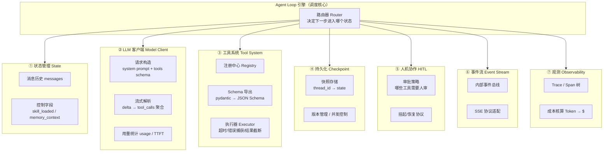
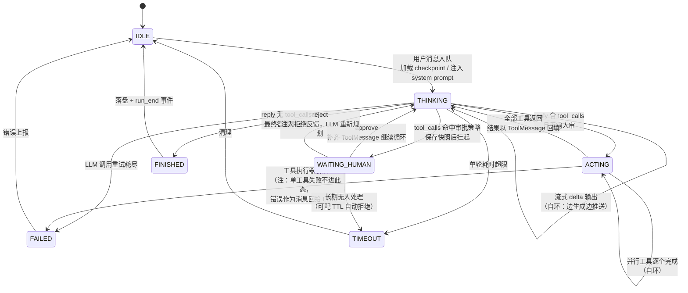
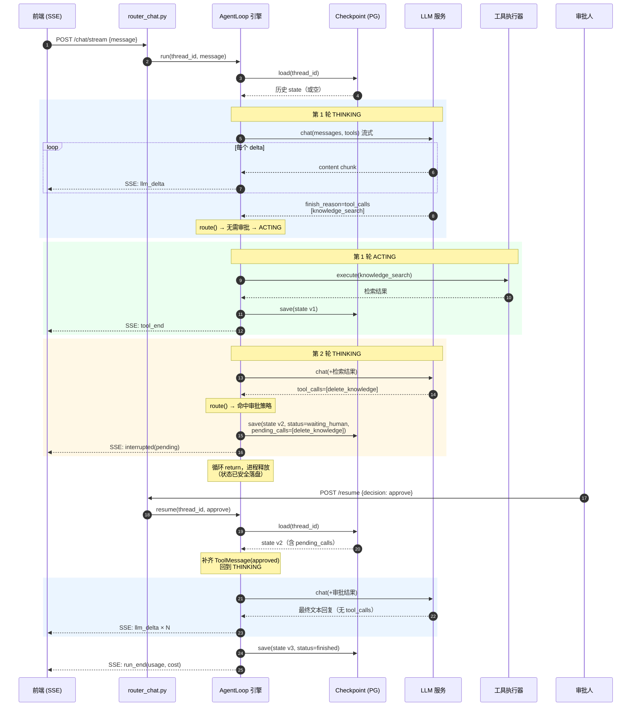
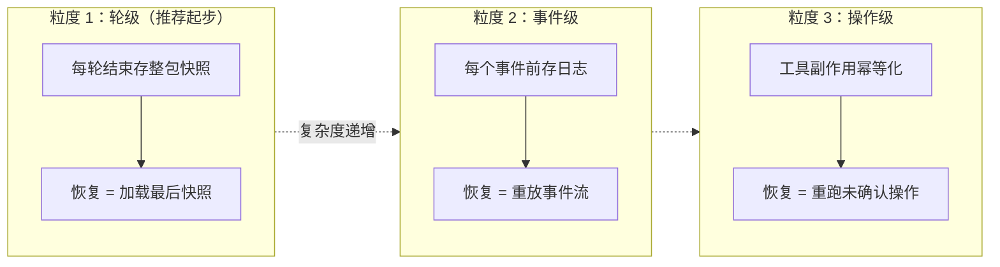
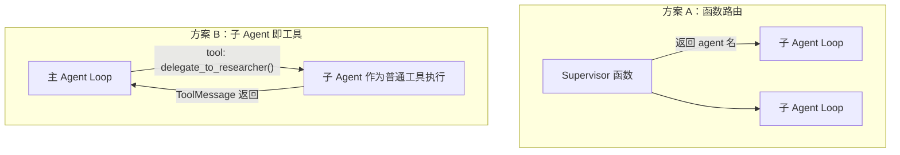
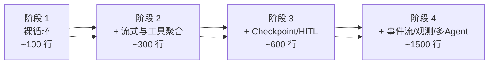

# Agent Loop 核心骨架深度解析 —— 自研设计与 LangGraph 对比学习报告

> 目标读者：想彻底搞懂 Agent 运行时本质的工程师。
> 分析基准：本项目 `backend/app/harness/` 的真实代码。
> 所有流程图均为 Mermaid，可在 IDE / GitHub 直接渲染。

---

## 目录

1. [第一性原理：Agent 到底是什么](#一第一性原理agent-到底是什么)
2. [Agent Loop 的完整解剖：七个组成部分](#二agent-loop-的完整解剖七个组成部分)
3. [状态机设计详解](#三状态机设计详解)
4. [一次完整对话的全链路时序](#四一次完整对话的全链路时序)
5. [Checkpoint 与中断恢复的设计](#五checkpoint-与中断恢复的设计)
6. [自研 vs LangGraph：逐层对比](#六自研-vs-langgraph逐层对比)
7. [自定义自由度分析：自研到底赢在哪](#七自定义自由度分析自研到底赢在哪)
8. [结合本项目的映射表](#八结合本项目的映射表)
9. [学习路线与练习建议](#九学习路线与练习建议)

---

## 一、第一性原理：Agent 到底是什么

剥掉所有框架包装，一个 Agent 只是一个**带工具的循环**：

```python
while True:
    reply = llm.chat(messages, tools)      # 思考
    if not reply.tool_calls:               # 判断：还要不要动手？
        return reply.content               # 不用了 → 结束
    results = execute(reply.tool_calls)    # 动手
    messages += [reply, *results]          # 把结果喂回去，继续循环
```

这就是全部。业界叫它 **ReAct 循环**（Reasoning + Acting）或 **tool-use loop**。

LangGraph、OpenAI Agents SDK、Claude Agent SDK……所有 Agent 框架的核心都是这个循环的工业化变体。它们额外解决的是**生产化问题**：

| 循环本身 | 生产化需求 |
|---|---|
| while 循环 | 持久化（进程崩了能恢复） |
| if 判断 | 人审（危险操作先停下来） |
| 工具执行 | 可观测（每一步花了多少钱） |
| 消息追加 | 流式输出（用户别等太久） |
| | 多轮会话隔离（thread_id） |
| | 超时 / 重试 / 限轮数 |

**理解了这张表，就理解了为什么"底座"看起来很复杂——复杂度几乎全在生产化，不在循环本身。**

### 本项目验证

看 `graph_builder.py` 的真实结构：

```
__start__ → agent ──(有 tool_calls)──→ tools ──┐
               └───(无 tool_calls)──→ END      │
                    ▲──────────────────────────┘
```

两个节点、一条回边。所谓"图"，实际就是一个二状态循环。

---

## 二、Agent Loop 的完整解剖：七个组成部分

一个生产级 Agent Loop 由七个正交组件构成。**每个组件都可以独立设计、独立替换**——这是理解所有 Agent 框架架构的钥匙。

### 组件全景图



下面逐一拆解每个组件的设计要点。

### ① 状态管理（State）

**职责**：定义"循环进行中需要携带的全部信息"。

最小集合只有两样：
- `messages`：对话历史（LLM 是无状态的，每轮都要全量重发）
- 控制字段：租户、已加载 Skill、记忆上下文等

**关键设计决策 1：消息如何更新？**

LangGraph 用 **reducer 模式**：节点返回增量 `{"messages": [new_msg]}`，框架用 `add_messages` 函数把增量合并进全局状态。好处是节点之间解耦、支持并行分支自动合并；代价是有一层隐式魔法，调试时要理解"返回值 ≠ 新状态，返回值是 delta"。

自研通常直接用 **append-only**：`state.messages.append(msg)`。直观、可断点调试，但要求你保证只有一个写者（单线程循环天然满足）。

> 本项目对应：`state.py` 的 `HarnessState(MessagesState)`，其中 `skill_loaded` 自定义了去重 reducer `lambda a, b: list(dict.fromkeys(a + b))`。

**关键设计决策 2：什么该进持久化状态？**

本项目踩过的坑值得记住（见 `context.py` 注释）：`dynamic_tools`、`model_api_key`、`attachments` 这些**请求级数据绝不能写入 checkpoint**——否则密钥落库、跨请求泄漏。正确做法是用 ContextVar 驻留请求作用域。

原则：**checkpoint 里只放"恢复执行所需的最小状态"，其余放请求上下文。**

### ② LLM 客户端（Model Client）

**职责**：把"一次思考"封装成可靠调用。这是自研时**工作量最大、坑最多**的部分。

必须处理的五件事：

1. **Prompt 组装**：system prompt（Skill 指令 + 记忆注入）+ 消息历史 + 附件（图片走多模态 content blocks）
2. **工具 Schema 绑定**：把工具定义转成 OpenAI function calling 格式随请求发送
3. **流式解析**：这是最大的坑——流式模式下 `tool_calls` 不是一次性到达，而是按 index 分片：

```json
// 第 1 个 delta
{"index": 0, "id": "call_abc", "function": {"name": "search", "arguments": "{\"qu"}}
// 第 2 个 delta
{"index": 0, "function": {"arguments": "ery\": \"lang\"}"}}
```

   必须自己按 index 聚合出完整的 name + arguments（JSON 字符串拼接后 parse）。LangChain 在 `ChatOpenAI` 内部帮你做了这件事，所以用框架时感知不到。

4. **用量提取**：最后一个 chunk 携带 `usage_metadata`（input/output tokens），用于成本核算
5. **重试与降级**：429 退避、超时熔断、连接失败切换备用端点

> 本项目对应：`base_agent.py` 的 `create_llm()` + `llm.bind_tools(tools)`；TTFT 统计在 `graph_runtime.py` 的 `on_chat_model_stream` 分支。

### ③ 工具系统（Tool System）

**职责**：让 LLM 能"看见"工具（schema），并安全地"使用"工具（执行）。

三个子模块：

- **Registry**：名字 → 工具实例的唯一登记处，禁止散落硬编码（本项目 `tools/registry.py` 已是此设计，可直接平移）
- **Schema 导出**：Python 函数签名/pydantic 模型 → JSON Schema。LangChain 的 `StructuredTool` 自动完成；自研需自己写 pydantic → OpenAI parameters 的转换（约 50 行）
- **Executor**：统一执行入口，负责：
  - 未授权工具拦截（返回 error ToolMessage 而非抛异常——让 LLM 能看到错误并自我修正）
  - 异常捕获 + 错误消息截断（防止工具报错刷爆上下文）
  - 输出长度限制（本项目 `settings.MCP_MAX_OUTPUT_BYTES`）

**容易被忽略的点**：工具执行结果必须以 `ToolMessage(tool_call_id=...)` 形式回填，且 id 必须与请求时的 call id 一一对应——这是 OpenAI 协议的硬约束，对不上号 API 直接报错。

### ④ 持久化 Checkpoint（下一节详述）

### ⑤ 人机协作 HITL（下一节详述）

### ⑥ 事件流 Event Stream

**职责**：把循环内部的每一步动作广播出去，供前端渲染过程面板。

两种实现哲学：

| 方案 | 做法 | 代表 |
|---|---|---|
| **事后解析** | 引擎发扁平事件流（run_id + parent_ids），消费端重建树 | LangGraph `astream_events(v2)` |
| **正向埋点** | 调用点显式 emit 事件，事件即事实 | 自研 |

本项目 `graph_runtime.py` 1440 行里约 70% 在做"事后解析"——维护 `pending_spans` 字典、`_resolve_parent` 回溯父节点、异常时兜底关闭未闭合 span。这些复杂度在正向埋点方案下**根本不会存在**。

### ⑦ 观测 Observability

Trace/Span 树、Token 成本核算、脱敏采样。这部分与循环引擎**完全正交**——只要事件流够清晰，观测层可以原样保留（本项目的 `observability/tracing.py` 就是独立模块）。

---

## 三、状态机设计详解

### 3.1 为什么用状态机视角看 Agent Loop

while 循环是代码视角；状态机是**行为视角**。状态机视角的价值在于：

1. **每个状态 = 一个持久化点** → 天然回答"什么时候存 checkpoint"
2. **每条边 = 一个显式转移条件** → 天然回答"路由逻辑放哪"
3. **挂起态（WAITING_HUMAN）是一等公民** → HITL 不再是框架魔法，而是"停在某个状态等输入"

### 3.2 完整状态图



### 3.3 七个状态的职责边界

| 状态 | 进入条件 | 核心动作 | 退出条件 | 是否落盘 |
|---|---|---|---|---|
| `IDLE` | 初始/收尾 | 等待用户输入 | 收到消息 | 否 |
| `THINKING` | 有新输入或工具结果 | 组装 prompt → 调 LLM → 流式输出 | 回复到达 | 是（回复追加后） |
| `ACTING` | 有待执行 tool_calls | 执行工具、捕获异常、回填结果 | 全部调用有结果 | 是 |
| `WAITING_HUMAN` | 命中审批策略 | 存快照、发 interrupted 事件 | 人给出决策 | **是（关键）** |
| `FINISHED` | 无 tool_calls | 发 run_end、核算成本 | — | 是 |
| `FAILED` | 重试耗尽/致命错 | 发 error 事件 | — | 可选 |
| `TIMEOUT` | 超限 | 中断并清理 | — | 可选 |

**设计要点**：

- `THINKING` 和 `ACTING` 的区分依据只有一条——**最后一条 AssistantMessage 是否携带 tool_calls**。这就是 LangGraph 里 `should_continue` 条件边的全部内容。
- `WAITING_HUMAN` 必须在**执行任何工具之前**进入。审批的对象是"即将发生的动作"，不是"已经发生的结果"。
- `FAILED` 与"工具报错"要严格区分：单个工具失败是**正常数据流**（LLM 看到错误会换思路重试），只有循环本身无法继续才算 FAILED。

### 3.4 路由函数：整个状态机的"心脏"

```python
def route(reply: AssistantMessage, policy: ApprovalPolicy) -> State:
    """全部路由逻辑，就这么多。"""
    if not reply.tool_calls:
        return State.FINISHED                    # 出口 1：任务完成

    pending = [c for c in reply.tool_calls
               if policy.needs_approval(c.name)] # 审批策略判定
    if pending:
        return State.WAITING_HUMAN               # 出口 2：等人

    return State.ACTING                          # 默认：干活
```

对比 LangGraph 的写法：

```python
# LangGraph 版：同样的逻辑，但分散在三处
builder.add_conditional_edges("agent", should_continue, ["tools", END])
builder.add_node("tools", tool_node)
graph = builder.compile(checkpointer=..., interrupt_before=["tools"])
```

逻辑量完全相同。区别在于：**自研把三处配置收敛成一个纯函数**，可以单测穷举所有分支；LangGraph 把它拆成 DSL 声明，换来的是可视化（`get_graph().draw_mermaid()`）和未来加并行分支的能力。

### 3.5 主循环参考实现（带注释的骨架）

```python
class AgentLoop:
    async def run(self, thread_id: str, user_msg: str) -> AsyncIterator[Event]:
        # ── 恢复或初始化 ──
        state = await self.checkpoint.load(thread_id) or AgentState.new()
        state.messages.append(Message.user(user_msg))

        for turn in range(self.max_turns):            # max_turns 防"思考死循环"
            # ═══ THINKING ═══
            emit(llm_start(turn))
            reply = await self.llm.chat(
                messages=self.prompt.build(state),     # system + history + memory
                tools=self.tools.schemas(),            # JSON Schema 列表
                on_delta=lambda d: emit(llm_delta(d)), # 流式透传
            )
            state.messages.append(reply)

            # ═══ 路由 ═══
            next_state = route(reply, self.policy)

            if next_state is State.FINISHED:
                break                                  # → FINISHED 分支

            if next_state is State.WAITING_HUMAN:
                await self.checkpoint.save(thread_id, state,
                    status="waiting_human",
                    pending_calls=reply.tool_calls)    # 快照必须含待审批调用
                emit(interrupted(reply.tool_calls))
                return                                 # 进程可安全退出

            # ═══ ACTING ═══
            results = []
            for call in reply.tool_calls:              # 串行；并行可用 gather
                try:
                    out = await asyncio.wait_for(
                        self.tools.execute(call),
                        timeout=self.tool_timeout)
                    results.append(Message.tool(call.id, out))
                except Exception as e:
                    results.append(Message.tool(call.id, f"error: {e}"))
            state.messages.extend(results)

            await self.checkpoint.save(thread_id, state)   # ← super-step 等价物

        # ── FINISHED ──
        await self.checkpoint.save(thread_id, state, status="finished")
        emit(run_end(usage=self.llm.total_usage))
```

**三个必须内建的保险丝**：
1. `max_turns`：LLM 可能陷入"调工具→失败→再调"死循环；
2. `tool_timeout`：单个工具卡死不能拖垮整个 loop；
3. 上下文长度检查：messages 无限增长会撞 token 上限，需要截断/摘要策略。

---

## 四、一次完整对话的全链路时序

以本项目真实场景为例：用户提问 → Agent 调知识库检索 → 需要人审的工具被拦截 → 批准后继续 → 最终回答。



**这张图里藏着三个关键认知**：

1. **中断 ≠ 异常**。第 12 步的 `return` 是正常控制流——因为状态已落盘，进程死了都能恢复。LangGraph 的 `interrupt_before` 本质也是这个，只是藏在框架内部。
2. **resume 是新请求、旧上下文**。`POST /resume` 触发的是一次全新的 HTTP 请求，引擎从 checkpoint 加载后继续跑，前后两次请求之间没有任何内存共享。
3. **每一轮边界都有 save**。这保证了任何时刻崩溃，最多丢失"当前正在进行的半轮"，不会丢已完成的工作。

---

## 五、Checkpoint 与中断恢复的设计

### 5.1 LangGraph 的 Checkpointer 做了什么

`AsyncPostgresSaver.setup()` 会建四张表：

| 表 | 内容 | 本项目是否用到 |
|---|---|---|
| `checkpoints` | 序列化的完整状态快照（msgpack 格式） | ✅ 核心 |
| `checkpoint_blobs` | 大对象分离存储（channel 值） | ✅（实现细节） |
| `checkpoint_writes` | 待写入的增量（pending writes） | ✅（HITL 用） |
| `checkpoint_migrations` | schema 版本管理 | ❌ 一次性 |

它的通用性来自支持：任意图结构、任意 channel 类型、时间旅行（回滚到任意版本）、跨线程 fork。**这些能力本项目一个都没用到**——只用到了"按 thread_id 存取最新快照"。

### 5.2 自研最小 Checkpoint

一张表就够了：

```sql
CREATE TABLE agent_checkpoints (
    thread_id   UUID        NOT NULL,
    version     INT         NOT NULL,     -- 单调递增 = 乐观锁
    status      TEXT        NOT NULL,     -- thinking/waiting_human/finished...
    state       JSONB       NOT NULL,     -- 自研 DTO 直接序列化
    created_at  TIMESTAMPTZ DEFAULT now(),
    PRIMARY KEY (thread_id, version)
);
CREATE INDEX idx_checkpoint_latest ON agent_checkpoints (thread_id, version DESC);
```

```python
class CheckpointStore:
    async def load(self, thread_id) -> AgentState | None:
        row = await db.fetch_one(
            "SELECT state FROM agent_checkpoints "
            "WHERE thread_id = :t ORDER BY version DESC LIMIT 1",
            {"t": thread_id})
        return AgentState.from_json(row["state"]) if row else None

    async def save(self, thread_id, state, *, expected_version: int):
        # 乐观锁：并发 resume 时后到者失败，防止双写
        await db.execute(
            "INSERT INTO agent_checkpoints (thread_id, version, status, state) "
            "VALUES (:t, :v + 1, :s, :st)",
            {"t": thread_id, "v": expected_version, ...})
```

**为什么用 JSONB 而不是 msgpack？**
- 可读：DBA 能直接 `SELECT state->'messages'` 排查线上问题；
- 可迁移：schema 变更只需 SQL，不用写反序列化兼容层；
- 性能差距在本项目规模下无感（单会话消息 < 100KB）。

LangGraph 选 msgpack 是为了通用性能和二进制兼容 LangChain 对象——你不需要兼容它们。

### 5.3 中断恢复的三种粒度



学习阶段做到**粒度 1** 即可覆盖 HITL 全部需求。粒度 3 是分布式事务思维（Saga），除非工具有昂贵副作用（如发邮件、付款）才值得做。

### 5.4 HITL 协议设计要点

- **pending_calls 必须进快照**：恢复时要精确知道"当时想执行什么"，不能靠重读 LLM 回复猜。
- **reject 的语义**：不是终止，而是给 LLM 一条反馈消息让它重新规划。反馈模板建议明确说明原因类别（权限不足/参数错误/时机不对）。
- **幂等防护**：同一个 resume 请求可能被网络重试触发，version 乐观锁天然防重放。

---

## 六、自研 vs LangGraph：逐层对比

### 6.1 总览

| 维度 | 自研 Loop | LangGraph |
|---|---|---|
| **心智模型** | 一个 while 循环 + 状态机 | 一张图（节点 + 条件边 + super-step） |
| **代码量** | ~1500 行核心 | 0 行（但需理解框架内部） |
| **学习曲线** | 前陡后平：概念少，坑要自己踩 | 前平后陡：上手快，调试黑盒痛苦 |
| **依赖面** | openai SDK + mcp SDK | langgraph + langchain-core + langchain-openai + adapters |
| **状态语义** | 显式对象，直接读写 | Channel + Reducer，声明式合并 |
| **持久化** | 自己设计表结构（JSONB） | 内置 4 表 msgpack 方案 |
| **HITL** | 显式状态 + resume 方法 | `interrupt_before` + `Command(resume=)` |
| **事件流** | 调用点正向 emit | `astream_events` 扁平流，消费端重建树 |
| **并行分支** | 自己写 asyncio.gather | 原生支持（同 super-step 多节点） |
| **时间旅行** | 不支持（除非自己实现） | 原生支持任意版本回滚 |
| **可视化** | 无（自己画 mermaid） | `get_graph().draw_mermaid()` |
| **升级风险** | 无外部 breaking change | 框架大版本迁移成本（v0.x→1.0 已发生过） |

### 6.2 同一问题的两种解法对照

**问题：工具执行前需要人审**

```python
# ── LangGraph 解法 ──
graph = builder.compile(
    checkpointer=saver,
    interrupt_before=["tools"],   # 声明式：在 tools 节点前暂停
)
# 恢复时：
await graph.ainvoke(Command(resume=approval), config={"thread_id": tid})
```

```python
# ── 自研解法 ──
if policy.needs_approval(reply.tool_calls):
    await checkpoint.save(tid, state, status="waiting_human",
                          pending_calls=reply.tool_calls)
    emit(Event.interrupted(...))
    return
# 恢复时：
async def resume(self, tid, decision):
    state = await checkpoint.load(tid)
    ...
```

LangGraph 的写法更短，但**审批粒度是节点级**的——想只审"危险工具"就得改图结构或用 `interrupt()` 函数式 API。自研把粒度控制放在自己的 `policy.needs_approval(name)` 里，一行策略代码的事。

**问题：统计每个 LLM 步骤的首字延迟（TTFT）**

```python
# ── LangGraph 解法：从事件流里捞 ──
# graph_runtime.py 真实代码逻辑：
if event["event"] == "on_chat_model_stream":
    if run_id not in self._ttft_map:          # 第一次 delta 即 TTFT
        self._ttft_map[run_id] = now() - self._llm_start_time[run_id]
```

```python
# ── 自研解法：调用点直接测 ──
t0 = time.monotonic()
reply = await llm.chat(..., on_first_delta=lambda: metrics.record_ttft(
    step_id, time.monotonic() - t0))
```

自研没有"事件是谁发的"这个间接层，指标与代码位置一一对应。

### 6.3 LangGraph 真正的优势（公平起见）

1. **并行分支 + join**：多个节点在同一 super-step 并发执行，reducer 自动合并结果。自研要手写 gather + 合并逻辑。
2. **子图嵌套**：把一张图作为另一个图的节点，状态自动映射。
3. **生态**：LangSmith 全链路追踪、Studio 可视化调试、海量教程。
4. **社区验证过的边界处理**：比如消息裁剪、token 预算、多模型 fallback 这些脏活有人替你踩过坑。

**判断标准**：如果你的编排拓扑会频繁变化、有真正的 DAG 并行需求 → 用框架；如果是"单循环 + 工具 + 人审"这类 ReAct 标准形态 → 自研更轻、更透明。

---

## 七、自定义自由度分析：自研到底赢在哪

按"定制深度"排序，七个自由度区间：

### 自由度 ①：Prompt 组装管线（收益最高）

LangChain 的 prompt 组装藏在 ChatModel 内部。自研后你可以：

- 按 token 预算动态裁剪历史（最近 N 轮全保留 + 更早轮次摘要压缩）
- Skill 指令按相关性注入（本项目 `base_agent.build_system_prompt` 已经在做，但受限于框架的消息构造方式）
- 缓存友好排列：把稳定内容（system + skill）放前面命中 provider 的 prompt cache，省钱且降延迟
- 多模态消息结构完全自主（图片、文件 block 的排布）

### 自由度 ②：路由与终止策略

- 终止条件不止"无 tool_calls"：可加"置信度评分"、"预算耗尽"、"用户中断信号"
- 中途换模型：简单步骤用便宜模型，复杂推理切强模型（LangGraph 里换模型要重建节点）
- 失败自愈：LLM 输出格式坏掉时注入修复提示重试，而不是直接 FAILED

### 自由度 ③：Checkpoint 内容与格式

- 敏感字段脱敏后落库（密钥、PII）
- 冷热分层：活跃会话在内存/Redis，完结会话归档 PG
- 只存增量（每轮只存新增消息），加载时拼装——百轮长对话下存储省一个量级
- 与业务表联动：checkpoint 和 messages 表同事务写入，天然一致

### 自由度 ④：事件协议与前端体验

- 事件即 API：想加"思考中"骨架屏？在 THINKING 入口加一个事件即可，不用研究 astream_events 的过滤规则
- 精确的进度语义：第几轮、共调了几个工具、当前在等谁
- 自定义背压：前端断线时暂停推送并缓冲，重连后补发

### 自由度 ⑤：观测埋点方式

- 从"逆向解析事件流重建 span 树"变成"顺序埋点"，`graph_runtime.py` 那 70% 的 span 配对代码消失
- Span 层级由调用栈天然决定，不会出现孤儿 span / 错误父子关系
- 成本核算精确到每次调用，而不是从 usage 事件里反推归属

### 自由度 ⑥：多 Agent 编排形态

LangGraph 的 supervisor 是"图套图"。自研有两种更轻的选择：



方案 B 让多 Agent 完全复用单 Agent 的全部机制（审批、观测、checkpoint），是业界趋势（OpenAI Agents SDK 的 handoff 本质就是它）。

### 自由度 ⑦：失败语义与限流

- 工具级熔断：某工具连续失败 N 次自动摘除，LLM 收到"工具暂不可用"
- 租户级并发闸门：同一 thread 同时只允许一个 loop 在跑（version 乐观锁已覆盖一半）
- 成本护栏：单次 run 的 token 预算超限即优雅收尾（让 LLM 总结已有信息作答）

> **一句话总结**：LangGraph 把"怎么跑"标准化了，你只能在它给的扩展点里定制；自研把"怎么跑"的控制权还给你，代价是所有边界情况自己负责。

---

## 八、结合本项目的映射表

现有 harness 代码到自研架构的一一对应关系：

| 现有文件 | LangGraph 依赖点 | 自研去向 | 迁移难度 |
|---|---|---|---|
| `state.py` HarnessState | MessagesState + add_messages reducer | `loop/state.py` 纯 dataclass + 手写 append | ★ |
| `graph_builder.py` | StateGraph / add_node / add_edge | `loop/engine.py` while 循环（整个文件被吸收） | ★★ |
| `base_agent.py` agent 节点 | ChatOpenAI.bind_tools | `llm/client.py`（工作量最大）+ prompt 组装平移 | ★★★ |
| `_tools` 节点 | ToolNode 语义 | `tools/spec.py` executor（registry.py 原样保留） | ★★ |
| `supervisor.py` | 固定路由边 | 子 Agent 即工具（见自由度⑥） | ★ |
| `checkpointer.py` AsyncPostgresSaver | 4 张表 msgpack | `storage/checkpoint.py` 单表 JSONB | ★★ |
| `graph_runtime.py`（1440 行） | astream_events 消费 + span 重建 | `events.py` 正向 emit + 观测埋点（预计缩至 ~300 行） | ★★ |
| `context.py` ContextVar | — | **原样保留**（设计正确，与框架无关） | 零 |
| `observability/tracing.py` | OTel | **原样保留**，仅埋点调用方式变化 | ★ |
| `router_chat.py` SSE 端点 | runtime.astream/resume 接口签名 | 保持接口不变，内部换引擎 → 前端零改动 | ★ |
| `tools/registry.py` | StructuredTool 泛型 | 泛型换成自研 ToolSpec，结构不动 | ★ |
| MCP 接入 | langchain-mcp-adapters | `mcp/adapter.py`：list_tools/call_tool 直连 | ★★ |

**结论**：约 60% 的项目代码（Skill/Memory/Knowledge/RAG/API 层）与 LangGraph 零耦合，完全不受影响。真正要动的是 harness 目录，核心新增代码约 1300~1600 行。

---

## 九、学习路线与练习建议

### 9.1 四阶段练习路径



**阶段 1 —— 最小可用循环（1 天）**
目标：不依赖任何框架，openai SDK + 两个假工具，跑通"提问 → 调工具 → 回答"。
验收：能解释 finish_reason 的三种取值分别驱动了什么分支。

**阶段 2 —— 流式与 tool_calls 聚合（2~3 天）**
目标：实现 delta 流转发 + 按 index 聚合 tool_calls 分片。
验收：让 LLM 连续调 3 个工具，打印每轮聚合出的完整调用参数；故意截断 arguments JSON 验证错误处理。

**阶段 3 —— 持久化与人审（3~5 天）**
目标：PG 单表 checkpoint + WAITING_HUMAN 状态 + resume API。
验收：**kill -9 杀掉进程后 resume，对话无损继续**——这是检验 checkpoint 设计的金标准。

**阶段 4 —— 生产化（1~2 周）**
目标：SSE 事件协议、OTel 埋点、max_turns/超时/token 预算三保险丝、子 Agent 即工具。
验收：与本项目的 LangGraph 版本做 A/B 对比，SSE 帧序列一致则前端无感切换。

### 9.2 必须亲手回答的十个问题（自测清单）

1. 流式模式下 tool_calls 的 arguments 为什么是分片到达的？如何聚合？
2. ToolMessage 的 tool_call_id 对不上会发生什么？
3. 为什么审批检查必须在工具执行之前、LLM 回复之后？
4. checkpoint 里为什么不能存 model_api_key？（本项目 context.py 的教训）
5. reject 之后 LLM 如何知道被拒绝了？反馈消息应该是什么 role？
6. max_turns 触发时，最后一条消息应该给用户看什么？
7. 乐观锁 version 冲突时（两人同时 resume）应该谁赢？
8. 上下文超过模型窗口时的三种裁剪策略及取舍？
9. 为什么"单个工具报错"不该进 FAILED 状态？
10. 如果明天要加"两个工具并行执行再汇总"，你的 loop 要改哪几行？

能流畅回答全部十题，说明你对 Agent 骨架的理解已经超过大多数框架使用者。

### 9.3 推荐阅读源码顺序

1. 本报告 §3.5 主循环骨架 → 自己默写一遍
2. `langgraph` 的 `StateGraph.compile()` 源码（重点看 PregelLoop 的 tick 机制，理解 super-step 与你的 for 循环的对应关系）
3. `langchain_openai` 的 `_convert_delta_to_message_chunk`（tool_calls 聚合的标准答案）
4. OpenAI Agents SDK 的 `_run_loop.py`（另一个工业实现的参照系，对比它与 LangGraph 的取舍）
5. Anthropic 的 "Building effective agents" 博文（何时该用 workflow、何时该用 agent 的决策框架）

---

## 附录：术语速查

| 术语 | 含义 |
|---|---|
| ReAct | Reasoning + Acting，LLM 交替思考和调工具的经典范式 |
| Super-step | LangGraph 的原子执行单元：一批节点并发跑完 + 状态合并 = 一步 |
| Reducer | 状态通道的合并函数，定义"两个增量如何合成新状态" |
| HITL | Human-in-the-loop，人工介入审批 |
| TTFT | Time To First Token，首字延迟 |
| Interrupt | LangGraph 的挂起机制，本质是"存快照 + 抛特殊异常" |
| Handoff | 把控制权移交给另一个 Agent 的模式 |
| Tool Spec | 工具的机器可读描述（名称 + JSON Schema 参数 + 描述文本） |

*报告完 — 基于 MyAgentDemo1 项目真实代码分析，2026-08*
